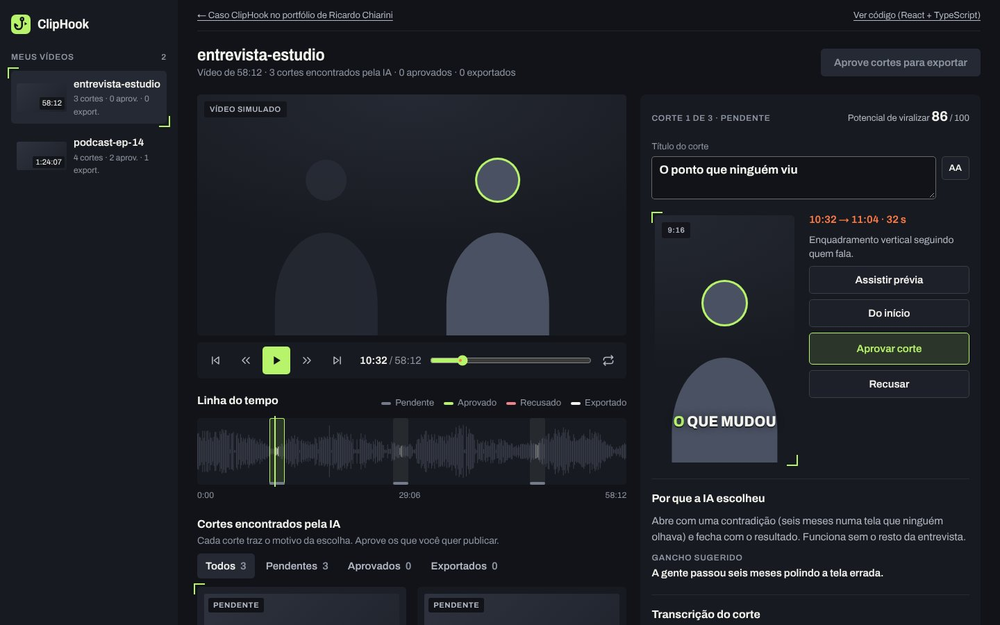

# Editor do ClipHook no navegador

Demonstração do editor de cortes do [ClipHook](https://cliphook.com.br), feita em React e TypeScript. Para ver funcionando, rode localmente (veja [Rodar](#rodar)).



O ClipHook é um app para Windows que encontra os melhores trechos de lives e podcasts e os transforma em cortes verticais. O app de verdade analisa os arquivos do editor no computador dele. Esta versão mostra a mesma interface e o mesmo fluxo no navegador, **com dados simulados**: os vídeos, as falas e as notas são fictícios, e nada é exportado.

## O que dá para fazer

- Reproduzir, avançar e voltar, e pular de um corte para o outro.
- Ver a linha do tempo com o áudio do vídeo inteiro e os trechos marcados.
- Ler o motivo de cada corte e a transcrição, com a palavra dita em destaque. Clicar numa palavra leva ao instante dela.
- Ver a prévia vertical (9:16), que se move para enquadrar quem está falando, com a legenda palavra a palavra.
- Aprovar ou recusar, editar o título e ajustar a entrada e a saída em décimos de segundo, ou encaixar as pontas na frase mais próxima.
- Exportar os aprovados (simulado).

Atalhos: `Espaço` reproduz, `←` `→` andam 5 s, `J` `K` trocam de corte, `A` aprova, `R` recusa.

## Como está organizado

| Arquivo | Papel |
|---|---|
| `src/estado.ts` | O estado do editor e as regras que o mudam, num redutor de funções puras (aprovar, ajustar, exportar). |
| `src/relogio.ts` | O relógio da reprodução, fora do React. |
| `src/dados.ts` | Os vídeos simulados: transcrição com horário por palavra e forma de onda gerada por semente. |
| `src/fala.ts` | Quem fala e qual palavra é dita em um instante; os blocos da legenda. |
| `src/componentes/` | As telas: lista de vídeos, player, linha do tempo, cartões de corte e o painel do corte. |

## Decisões

- **O tempo fica fora do estado do React.** Ele muda a cada quadro. Se morasse no estado global, a tela inteira redesenharia sessenta vezes por segundo. O relógio é um objeto pequeno com assinatura, e só os componentes que mostram o tempo o leem com `useSyncExternalStore`. A agulha da linha do tempo nem passa pelo React: mexe direto no estilo.
- **Regras em funções puras.** Aprovar, ajustar e exportar são funções de `(estado, ação) → estado`, testadas sem navegador.
- **A onda é desenhada uma vez.** O canvas só redesenha quando muda o vídeo, um corte ou o tamanho da caixa. Os marcadores dos cortes são botões de verdade por cima dele, para funcionarem com teclado e leitor de tela.
- **Fiel ao app.** A demonstração só tem o que o app tem. Não há arrastar para aparar nem reordenar cortes, porque o app não faz isso.
- **Sem biblioteca de interface ou de estado.** React, TypeScript e CSS.

## Rodar

```bash
npm install
npm run dev
```

Outros comandos: `npm test` (Vitest), `npm run typecheck` e `npm run build`.

## Licença

Código aberto para leitura, como portfólio. Todos os direitos reservados: veja [LICENSE](LICENSE).

## Créditos

Design, código e produto por [Ricardo Chiarini](https://ricardochiarini.com). A fonte é a [Archivo](https://github.com/Omnibus-Type/Archivo), sob a licença SIL Open Font License (ver `src/fontes/OFL-Archivo.txt`).
